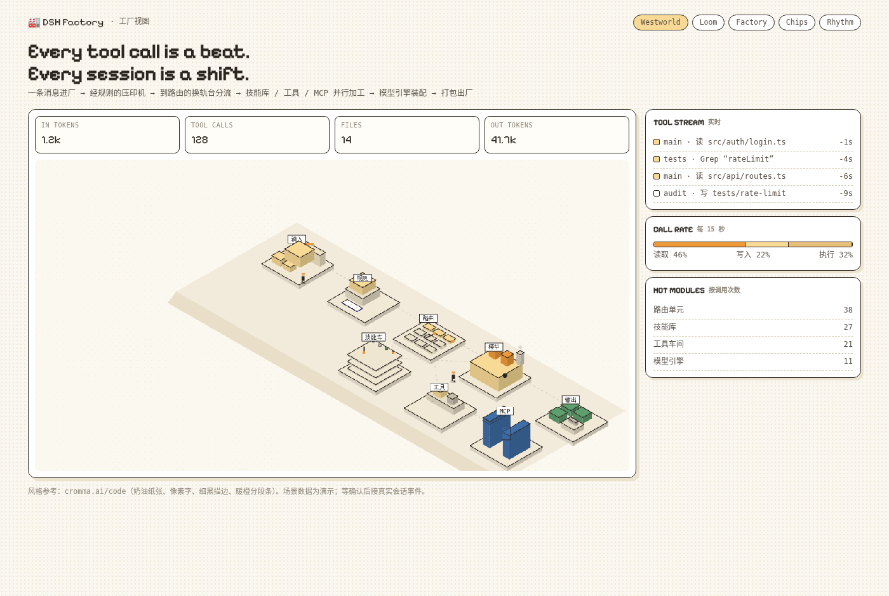

# dsh-factory

> 把 DSH Agent 的内部结构画成一张 **等距伪 3D 工厂蓝图**，由 3082 上的真实会话事件驱动动画。
> 两套皮肤：像素工厂 / 水流管道；同一套事件、同一套 2:1 等距视角。



## 一句话

- **物料** = 用户输入装进一个封好的箱子；
- **车间** = 编排 / 装配 / Skill / MCP·工具 / 路由 / 模型 / 仓储；
- **动画** = 箱子沿传送带流经车间，工人搬运、活塞/齿轮/机械臂运转、拆箱火花、命中技能贴标、出库封箱；
- **驱动** = `factoryTrail` session projection 折叠真实 session 事件；`agent/pre-step`、`agent/request`、`tool/call` 等进程事件通过宿主机 live 接口补充到同一播放队列；
- **没有事件就不动**：空闲时箱子停在当前站，不跑假动画。

## 快速使用（3082）

1. 打开 `http://127.0.0.1:3082`，进入任意会话。
2. 对话上方会出现一条 **「工厂」** 细条（`conversation.input.dock`）：
   - 点它 → 弹出完整工厂蓝图（模态）；
   - 或点会话头部的 **「工厂」** tab → 在对话视图里全屏看。
3. 顶部工具条：
   - `像素工厂` / `水流管道`：切换皮肤（同一套等距场景）；
   - `1×` / `0.5×`：播放速度；
   - `单步`：暂停自动播放，手动「下一步」；
   - `跳到最新`：清空播放队列；
   - `重播本轮`：把本 turn 的真实事件重新播放一遍（最多 60 个）。
4. 点任意车间 → 右侧面板：职责、本 turn 实际发生（工具名 / skill 名 / MCP 端点 / 子代理）、数据走量、可配置点。

### 事件驱动的验收路径

- 普通提问：`1 + 1 等于几` → 箱子从入口 → 编排 → 装配 → 模型 → 出口。
- 触发 skill：`/html-report 用 bash 执行 echo ...` → 箱子在 Skill 车间扫描 4 个技能库，命中 `html-report` 贴标；随后在 MCP/工具车间弹出真实 `bash` 请求/响应窗口。
- 触发子代理：`subagent/catalog` → 路由车间亮起，详情里显示子代理 label / mode / id（已实现并有单测；本次 3082 演示未实际派子代理，故无 live 子代理截图）。

## 架构

```
浏览器 (src/client.js)
  ├─ conversation.view        → 全屏工厂 tab
  ├─ conversation.input.dock  → 对话上方细条 + 模态
  ├─ useProjection('factoryTrail') → 宿主机折叠好的 per-session 状态
  ├─ 播放队列（0.6–1.5s/事件，可 0.5× / 单步）
  └─ SVG 等距场景 + HTML 浮层（技能扫描 / 工具窗口 / 路由闸门）
          ▲
          │ session projection + live HTTP
宿主机 (src/host.js)
  ├─ sessionProjections.register('factoryTrail')
  │    fold: turn/start, turn/end, step/start, step/end,
  │          system/message, user/message, developer/message,
  │          request/header, request/context,
  │          assistant/message, assistant/attempt,
  │          tool/call, tool/result, subagent/catalog
  ├─ POST /api/dsh-factory/live
  │    agent/pre-step (瀑布，调 next() 后记 post-step)
  │    agent/request (瀑布)
  │    agent/turn-stopping
  │    session/event: step/start, tool/call, assistant/message, turn/end
  └─ POST /api/dsh-factory/libraries
       从 ctx.skills.list() 读取真实技能库（4 类：用户 / 项目 / Agents / 运行时·插件）
```

### 为什么同时用 projection 和 live 接口

- **projection** 是持久、可回放、跨客户端一致的事实源：刷新、换浏览器、冷读都看到同一状态。
- **agent/pre-step / agent/request** 是进程事件，没有持久 seq，不能写进 session log；用宿主机内存 live trace + 短轮询补进播放队列，并保留最近 12 条历史，避免 360ms 轮询漏掉很短的 pre-step。
- `post-step` 是 `agent/pre-step` 的 `next()` 返回后记录的进程标记；它不持久，界面只用于 live HUD / trace，持久回放以 `step/end` 为准。

## 安装 / 启用 / 回滚

### 安装到 superagent profile（3082）

```bash
# 1) 依赖
cd ~/.dsh/profiles/superagent
# 备份 package.json / pnpm-lock.yaml / cordis.patch.yml
node -e "const fs=require('fs');const p='package.json';const j=JSON.parse(fs.readFileSync(p));j.dependencies['dsh-factory']='link:/home/tank543/src/dsh-factory';fs.writeFileSync(p,JSON.stringify(j,null,2)+'\n')"
pnpm install

# 2) 启用 bundle
node -e "const fs=require('fs');const p='package.json';const j=JSON.parse(fs.readFileSync(p));if(!j.dsh.profile.bundles.includes('dsh-factory'))j.dsh.profile.bundles.push('dsh-factory');fs.writeFileSync(p,JSON.stringify(j,null,2)+'\n')"
```

HMR 会在 bundle 列表变化时重组 profile，**不需要重启 3082**。如果 host 端代码没有热替换，给 `~/.dsh/profiles/superagent/cordis.patch.yml` 追加一行注释（内容变化会触发 recomposition）：

```bash
printf '\n# dsh-factory reload %s\n' "$(date +%s)" >> ~/.dsh/profiles/superagent/cordis.patch.yml
```

### 回滚

```bash
cd ~/.dsh/profiles/superagent
# 恢复备份（package.json / pnpm-lock.yaml / cordis.patch.yml 的 .bak-dsh-factory-*）
# 或只移除：
node -e "const fs=require('fs');const p='package.json';const j=JSON.parse(fs.readFileSync(p));j.dsh.profile.bundles=j.dsh.profile.bundles.filter(x=>x!=='dsh-factory');delete j.dependencies['dsh-factory'];fs.writeFileSync(p,JSON.stringify(j,null,2)+'\n')"
pnpm install
```

如果 HMR 没有自动卸载，追加一行 `cordis.patch.yml` 注释触发 recomposition，或经用户批准重启 `dsh-superagent.service`。
插件只新增 session projection / 两个只读 HTTP 路由 / 两个客户端 slot，不修改 DSH 本体、不写 session log、不删除任何用户数据。

## 开发

```bash
cd /home/tank543/src/dsh-factory
pnpm install
node build.mjs          # src/host.js → lib/index.js；src/client.js → lib/client.js（CJS wrapper）
node --test test/*.test.mjs
```

- 无运行时构建依赖；host 只依赖 `zod`（用于 projection schema）。
- 客户端 bundle 由 DSH module loader 以 CJS 包装加载；只 `require('react')`。
- 截图/录屏脚本使用本机 Chrome CDP（9333），不是插件运行时依赖：
  - `node scripts/capture-static.mjs` → 两主题静帧 + skill/tool 浮层
  - `node scripts/capture-water-overlays.mjs` → 水主题 skill/tool 浮层
  - `node scripts/record.mjs` → `docs/dsh-factory-demo.mp4`

## 视觉规范

详见 [`docs/aesthetic.md`](docs/aesthetic.md)。

- 固定 2:1 等距，32px 基础网格；站房占地 96/128/160。
- 16 色低饱和：暖灰/木色/黄铜/蒸汽白 + 冷钢/青。
- 三面明暗 + 顶面高光 + 地面接触阴影；无纯黑硬描边。
- 环境：草地/花/树/木箱/桶/路灯/管线/水箱/栅栏/烟团/雾。
- 动画只用 transform/opacity，无 rAF；IntersectionObserver 离屏暂停（目标 30fps 的合成层动画）。

## 截图 / 录屏

| 文件 | 说明 |
|---|---|
| `docs/screenshots/factory-lane.png` | 截图 | 
| `docs/screenshots/old-2d.png` | 截图 | 
| `docs/screenshots/palette-16.png` | 截图 | 
| `docs/screenshots/static-pixel-clean.png` | 截图 | 
| `docs/references/isometric-pixel-factory-unity.jpg` | 外部参考图（仅对照） |
| `docs/dsh-factory-demo.mp4` | 真实 turn 事件回放，两主题 + 工人/机器/拆箱/贴标/工具窗口 |

## 已知问题 / 边界

1. **伪 3D，不是真 3D**：没有 z 排序/遮挡；极少数传送带/管线交叉用「桥」视觉标记，不做几何避让。
2. **SVG 手绘，不是 32px 点阵 sprite**：2× 仍清晰，但不是严格像素画；字体用系统字体。
3. **live pre-step 是短轮询 + 历史**：360ms 轮询 + 宿主保留最近 12 条历史；极端短 step 仍可能在 HUD 上只显示最终 phase。持久回放以 `step/end` 为准。
4. **MCP 端点**：代码支持 `mcp__<server>__<tool>` 并显示 `mcp://server`；本次演示环境没有配置 MCP server，所以工具窗口显示 `tool://local`（真实 bash 调用）。
5. **对话上方展开是模态**：`conversation.input.dock` 的 inline 高度会被 composer stack 裁切，改为点击细条弹出模态；触发位置仍在对话上方。
6. **录屏是真实事件回放**：不是录模型思考过程；播放的是 3082 上真实 turn 的 session/live 事件。
7. **额度**：2026-11-18 深夜曾因额度用尽出现 2 次 `QUOTA` 失败；00:00 后恢复，普通提问、skill + bash 提问均成功（见 `docs/live-phase-log.txt`）。
8. **子代理派工未 live 验证**：投影折叠 `subagent/catalog`、路由面板与单测都已完成；本次 3082 演示没有实际派子代理，故没有 live 子代理截图。

## 文件结构

```
src/host.js              # 投影 / live 路由 / 技能库路由
src/client.js            # 两套皮肤、等距 SVG、播放队列、面板
build.mjs                # 零依赖构建
lib/index.js             # 构建产物（host）
lib/client.js            # 构建产物（browser CJS wrapper）
cordis.patch.yml         # bundle patch
test/fold.test.mjs       # 折叠 / 分类 / live history 单测
scripts/cdp.mjs          # 截图/录屏用 CDP 客户端
scripts/capture-static.mjs
scripts/capture-water-overlays.mjs
scripts/record.mjs
docs/aesthetic.md        # 参考 / 色板 / 设计规范
docs/live-phase-log.txt  # 3082 真实事件探测记录
docs/screenshots/*.png
docs/dsh-factory-demo.mp4
```
